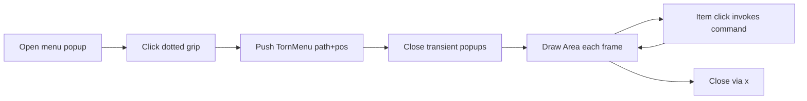

# Application menu tear-off

## Approach

Reuse the **tool flyout tear-off host pattern** ([`crates/ui-egui/src/toolbar.rs`](crates/ui-egui/src/toolbar.rs) `floating_strips` / dotted grip), applied to the in-window menu tree in [`crates/ui-egui/src/menus/bar.rs`](crates/ui-egui/src/menus/bar.rs).

Menus today are ephemeral `Popup::menu` hosts; item clicks always call `ui.close()`:

```173:176:crates/ui-egui/src/menus/bar.rs
    if r.clicked() {
        *clicked = row.target().map(|target| with_held_keys(target, ui.input(|i| i.modifiers)));
        ui.close();
    }
```

Torn menus leave that popup path: they live in a persistent `egui::Area` and skip `ui.close()` on action.



## Scope (locked)

- **In-window menu bar only** (Windows/Linux/web, and macOS with `--in-window-menus`). Native macOS menu bar is unchanged.
- **Top-level and nested submenu popups** each get a grip (“any application menu”).
- **Not** canvas/ruler context menus.
- **Session-only** state (no prefs/workspace serde, no `window.floatMenu` command) to keep the change small.
- Tear by **click** on the grip (as requested); dragging the grip after tear moves the floating menu.

## Implementation

### 1. State

Add to [`crates/ui-egui/src/state.rs`](crates/ui-egui/src/state.rs) (non-persisted field, or `#[serde(skip)]` if near other UI fields):

```rust
pub struct TornMenu {
    /// English tree keys, e.g. ["View"] or ["Object", "Arrange"].
    pub path: Vec<String>,
    pub pos: [f32; 2],
}
// UiState { … torn_menus: Vec<TornMenu> }
```

Helper: resolve `path` against `menu_tree_named(...)` to live `&[Item]` each frame (so enabled/checked stay current; never snapshot labels).

### 2. Grip + conditional dismiss in menu rendering

In [`crates/ui-egui/src/menus/bar.rs`](crates/ui-egui/src/menus/bar.rs):

- Introduce a small host flag (`keep_open: bool`) threaded through `menu_body` → `render_items` → `render_row` / submenu bodies.
- At the top of every popup body (top-level and `ui.menu_button` children), draw a **horizontal dotted grip** (same stroke style as the flyout vertical dots around `toolbar.rs` ~702–705; horizontal like the Tools panel grip ~173–176). Sense: click (tear) when `!keep_open`; drag+× when torn.
- On grip click in a popup: record `path` + current popup screen pos into `app.ui.torn_menus` (replace same path if already torn), then close open popups (`ui.close()` / close popup ids).
- In `render_row`: call `ui.close()` **only when `!keep_open`**.

Pass a stable English path into nested submenu draws (title key + submenu label keys from `Item::Sub`).

### 3. Floating host draw loop

New small module e.g. [`crates/ui-egui/src/menus/torn.rs`](crates/ui-egui/src/menus/torn.rs) (or functions in `bar.rs` if tiny):

- Each frame, for each `TornMenu`, `egui::Area` at `Order::Middle`, `fixed_pos`, menu chrome (`flyout_frame` or equivalent menu frame), grip with ×, then `render_items(..., keep_open: true, ...)`.
- Clamp on-screen (reuse `tools_float::clamp`).
- Drag grip updates `pos`; × removes the entry.
- Invoke path: collect `clicked` like `menu_bar`, then `invoke` / field-event deferral — same as the bar.
- Call from [`crates/ui-egui/src/chrome.rs`](crates/ui-egui/src/chrome.rs) (or `app.rs` next to other floating UI) every frame so torn menus survive after the bar popup closes.
- Do **not** fold torn Areas into `menu_open()` (docking already lowers float panels for bar popups only).

### 4. Tests

Extend [`crates/ui-egui/src/menus/tests.rs`](crates/ui-egui/src/menus/tests.rs):

- Clicking an item in a torn host sets/invokes without removing the torn entry.
- Clicking the grip on an open top-level menu adds a `TornMenu` with the expected path and closes the popup.
- × removes it.
- Existing hover-switch / bar-starts-at-File tests remain green.

### 5. Docs (light)

One evidence bullet under UI chrome in [`docs/target-app-parity.md`](docs/target-app-parity.md) (and a line in [`docs/ui-parity.md`](docs/ui-parity.md) if there is a menus/chrome checklist). Scores/hours unchanged — enhancement beyond current gap list; no `docs/gaps.md` entry exists for this.

## Out of scope

- Persisting torn menus in prefs/workspaces
- Control/MCP `window.floatMenu`
- Tear-off for context menus or the native macOS menu bar
- Changing command semantics beyond staying open after invoke
